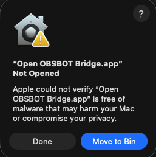
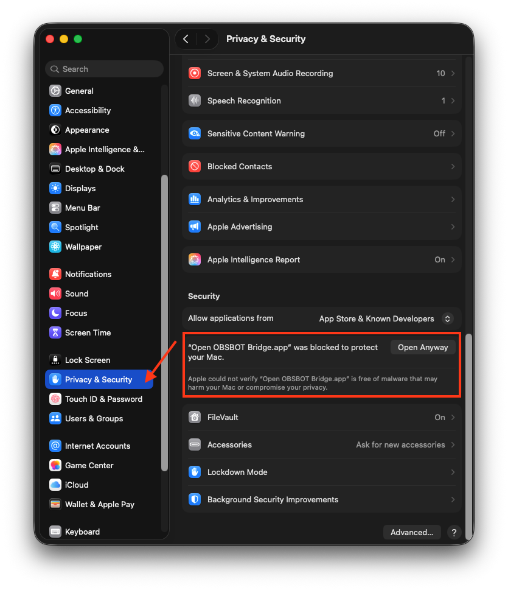
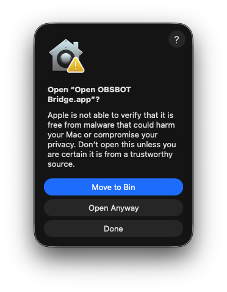
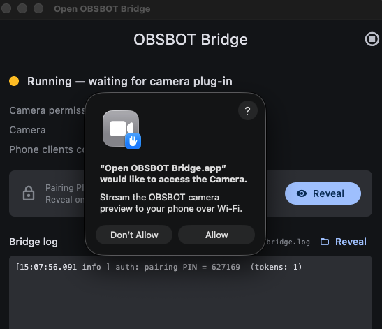
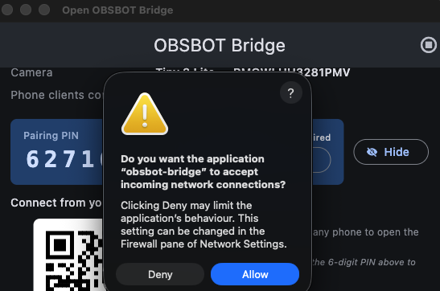

# Install the bridge

This guide takes you from a downloaded release to a paired phone and a live picture in OBS.

- On a Mac, start at [Install on macOS](#install-on-macos).
- On a Windows PC, start at [Install on Windows](#install-on-windows).
- On Linux the bridge runs headless, with no app; see [Linux](LINUX.md).

After installing, both platforms continue at [Pair a controller](#pair-a-controller).

## Install on macOS

The Homebrew cask clears the download quarantine for you, so it skips the Gatekeeper steps.
Use the DMG only when you want a specific version or cannot use Homebrew.

### Prerequisites

- You have a Mac running macOS 12 Monterey or later.
- You have at least 1 OBSBOT camera connected over USB.
- You have quit OBSBOT Center. Both apps claim the same camera control endpoint, and PTZ commands fail with `device_busy` while it runs.
- You have OBS installed on the same Mac, or on another machine on the same network.

### Install with Homebrew

Run:

```bash
brew install --cask 0xharkirat/tap/open-obsbot-bridge
```

The command taps [0xharkirat/homebrew-tap](https://github.com/0xharkirat/homebrew-tap), installs the app into `/Applications`, and clears the quarantine flag.
Upgrade later with `brew upgrade --cask open-obsbot-bridge`.

Open the app from `/Applications`, then continue at [Grant camera access](#grant-camera-access).

### Install from the DMG

1. Download `Open-OBSBOT-Bridge-universal.dmg` from the [latest release](https://github.com/0xharkirat/open-obsbot-remote/releases/latest). The build runs on both Apple Silicon and Intel.
2. Open the DMG and drag `Open OBSBOT Bridge.app` into `Applications`.
3. Clear the quarantine flag:

   ```bash
   xattr -dr com.apple.quarantine "/Applications/Open OBSBOT Bridge.app"
   ```

Step 3 replaces the 3 Gatekeeper dialogs described in [Clear Gatekeeper by hand](#clear-gatekeeper-by-hand).
After it, open the app and continue at [Grant camera access](#grant-camera-access).

#### Clear Gatekeeper by hand

Take this route when you would rather not run the `xattr` command.
The app is ad-hoc signed rather than notarized, so macOS blocks the first launch.

1. Double-click `Open OBSBOT Bridge` in `Applications`. macOS reports that the app was not opened. Click **Done**. Do not click **Move to Bin**.

   

2. Open **System Settings** > **Privacy & Security**, and scroll to the Security section. Next to the message that the app was blocked, click **Open Anyway**.

   

3. At the confirmation dialog, click **Open Anyway** again, and enter your Mac password if you are asked for it.

   

These 3 dialogs appear only on the first launch.

### Grant camera access

1. At the Camera access prompt, click **Allow**.

   

   Answer within 60 seconds. The capture path times out after that, and you have to grant access and restart the bridge.

2. At the firewall prompt, click **Allow** so `obsbot-bridge` can accept incoming connections.

   

## Install on Windows

### Prerequisites

- You have a 64-bit PC running Windows 10 or 11.
- You have at least 1 OBSBOT camera connected over USB.
- You have quit OBSBOT Center, for the same reason as on macOS.
- In OBS, no **Video Capture Device** reads the OBSBOT. On Windows, only one app can use a camera at a time. If OBS opens the camera first, the bridge gets no picture. OBS must read the camera through the bridge. See [Point OBS at the bridge](#point-obs-at-the-bridge).

### Run the installer

1. Download `Open-OBSBOT-Bridge-Setup-<version>-x64.exe` from the [latest release](https://github.com/0xharkirat/open-obsbot-remote/releases/latest).
2. Run the file. The installer is not code-signed. Thus Windows SmartScreen can show **Windows protected your PC**. Click **More info**, then click **Run anyway**.
3. At the administrator prompt, click **Yes**. The installer must have this permission to add the firewall rule.
4. Optional: tick **Start the bridge when I sign in to Windows**. Use this on a PC that must be ready when it starts.
5. Click **Finish**. Keep **Launch Open OBSBOT Bridge** ticked.

The installer adds a Windows Firewall rule for `obsbot-bridge.exe`. Thus phones can connect, and Windows does not ask about the firewall.
The rule is for private and public networks. Windows usually classes venue Wi-Fi as public. A rule for private networks only blocks all phones there.

To check the download, compare its SHA256 with `SHA256SUMS-<version>.txt` on the release page:

```powershell
Get-FileHash .\Open-OBSBOT-Bridge-Setup-*-x64.exe
```

### Portable zip

`Open-OBSBOT-Bridge-<version>-windows-x64.zip` has the same files, with no installer.
Extract it to a folder, and run `open_obsbot_bridge.exe`.
Windows Firewall then asks about `obsbot-bridge.exe` one time. Tick **Private** and **Public**, then click **Allow**.

### Camera access

Windows does not ask for camera permission for each desktop app.
If the preview stays blank, open **Settings** > **Privacy & security** > **Camera**. Turn on **Let desktop apps access your camera**.

### Uninstall

Click **Settings** > **Apps** > **Installed apps** > **Open OBSBOT Bridge** > **Uninstall**.
The uninstaller removes the firewall rule.
It keeps your pairing PIN, paired phones and saved sequences in `%APPDATA%\Open OBSBOT Bridge`. Thus a new install keeps them. To start again with no data, delete that folder.

## Pair a controller

1. In the bridge window, click **Reveal**. The pairing PIN and QR code show for 60 seconds.
2. Choose a controller:

   - Phone browser: scan the QR code. The web remote opens and pairs itself, because the QR encodes the PIN in the URL fragment.
   - Phone app: tap **Scan QR** on the connect screen.
   - Desktop app: click **Copy link** in the bridge window, then **Paste link** on the connect screen.
   - Any device, by hand: open `http://<bridge-ip>:8765/` and enter the 6-digit PIN. The bridge window lists the bridge's address, its Wi-Fi or Ethernet address first.

The controller stores a token, so later connections need no PIN.

## Point OBS at the bridge

1. In the bridge window, copy the OBS output URL.
2. In OBS, add a **Media Source**, and clear **Local File**.
3. Paste the URL into **Input**, and set **Input Format** to `mjpeg`.
4. Set **Reconnect Delay** to 2 seconds, and clear **Restart playback when source becomes active**.
5. In **FFmpeg Options**, enter:

   ```text
   reconnect=1 reconnect_streamed=1 reconnect_delay_max=2
   ```

A Media Source decodes the stream with ffmpeg. A Browser Source runs a full Chromium instance for the same job, drops frames under load, and never reconnects when a stream ends.

## Verification

- The bridge window shows each connected camera with a status dot and a preview.
- The remote shows the camera bus, and pressing **TAKE** changes which camera OBS displays.
- The bridge log records `video: capture session started`. On macOS:

  ```bash
  grep "capture session started" ~/Library/Logs/Open\ OBSBOT\ Bridge/bridge.log
  ```

  On Windows:

  ```powershell
  Select-String "capture session started" "$env:LOCALAPPDATA\Open OBSBOT Bridge\Logs\bridge.log"
  ```

## Troubleshooting

| Symptom | What to check |
| --- | --- |
| Preview is blank (macOS) | Confirm camera permission for Open OBSBOT Bridge in System Settings > Privacy & Security > Camera. If you left the first prompt unanswered, grant it and restart the bridge. |
| Preview is blank (Windows) | A different app uses the camera, for example an OBS Video Capture Device, OBSBOT Center or Teams. The log shows `mf: camera is in use by another app`. Close that app. The preview starts again in 2 seconds. Also make sure that **Let desktop apps access your camera** is on. |
| The controller cannot connect | Put the controller and the bridge on the same network. VPNs and guest Wi-Fi usually block local devices. Use the bridge's Wi-Fi or Ethernet address. Do not use a `100.x` Tailscale address, unless the phone also uses Tailscale. |
| The controller cannot connect (Windows zip) | The firewall rule is missing, or it is for private networks only. Open **Allow an app through Windows Defender Firewall**. For `obsbot-bridge.exe`, tick **Private** and **Public**. Or use the installer, which adds the rule. |
| PTZ commands fail with `device_busy` | Quit OBSBOT Center, then restart the bridge. |
| A camera never appears | Try another USB cable or port. Cameras take 6 to 20 seconds to enumerate. |
| OBS shows a frozen frame | Confirm the source is a Media Source with a reconnect delay, not a Browser Source. |

## Next steps

- [Run and test](RUN.md) covers the manual test pass.
- [Cameras](CAMERAS.md) lists model support.
- [Build from source](BUILD.md) covers development builds.
